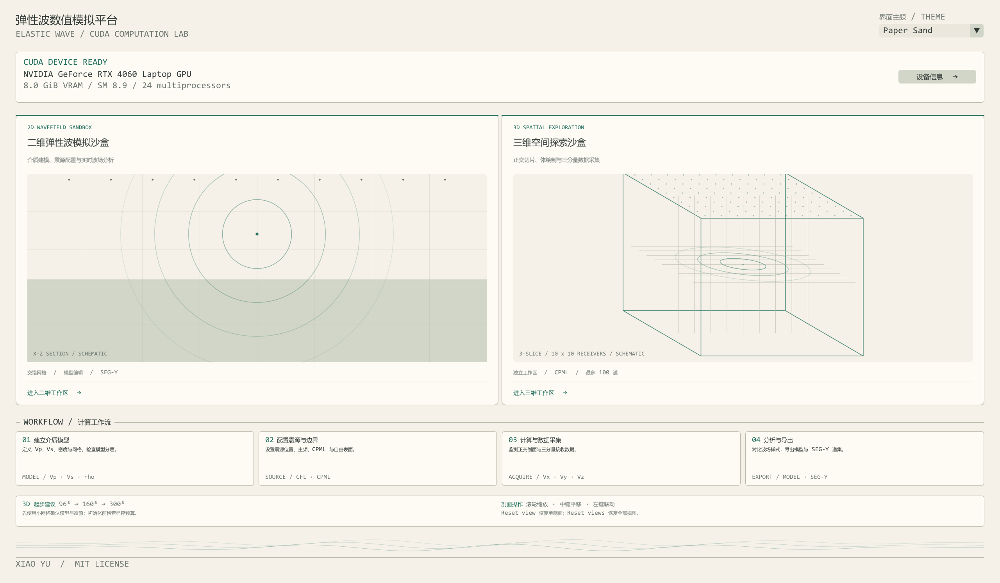
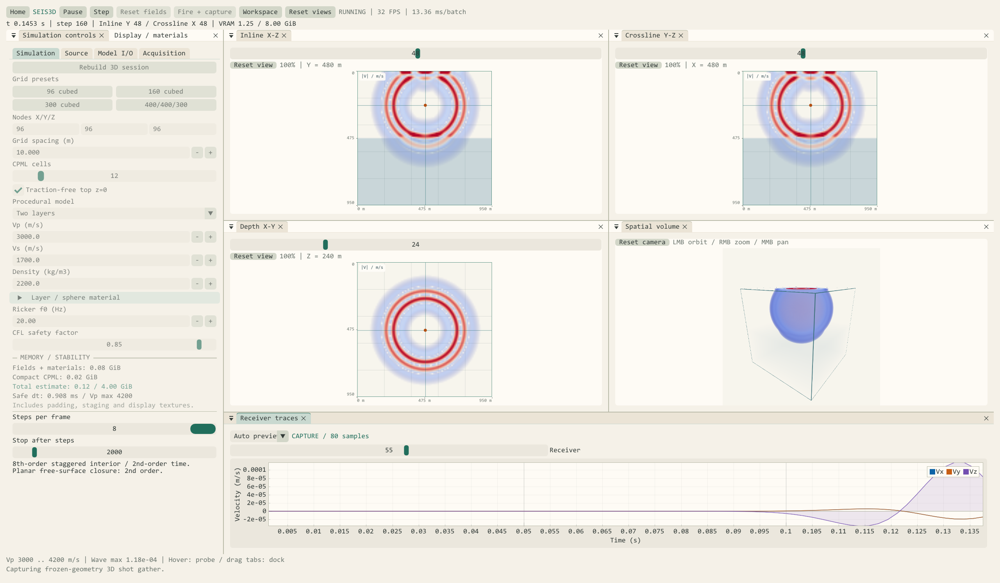
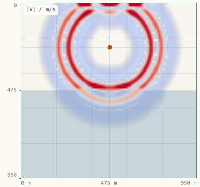
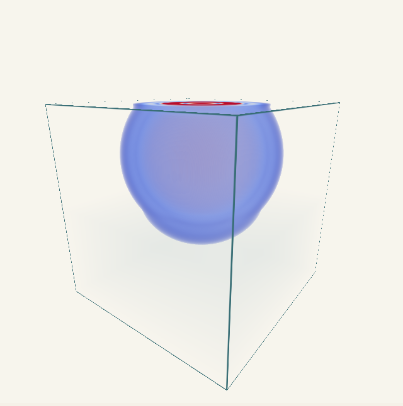
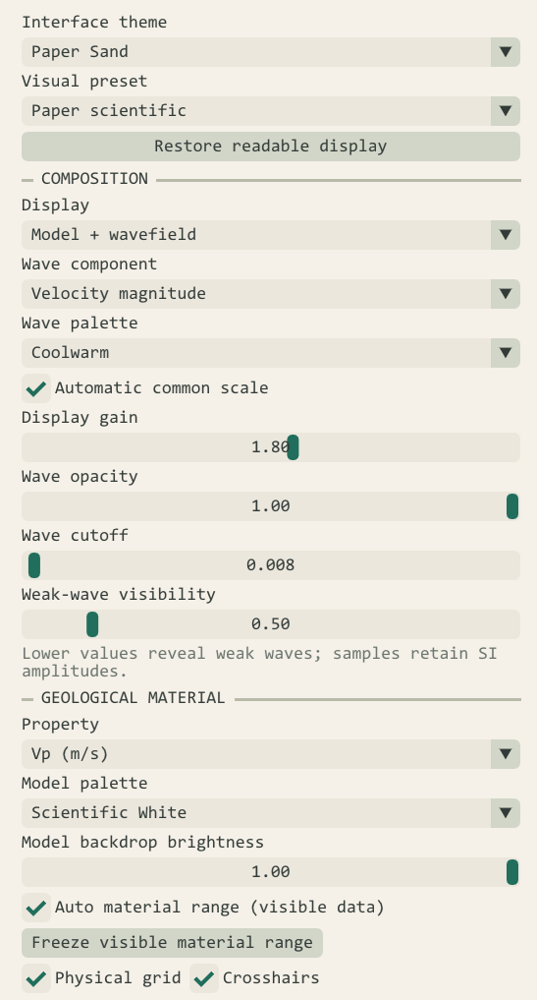
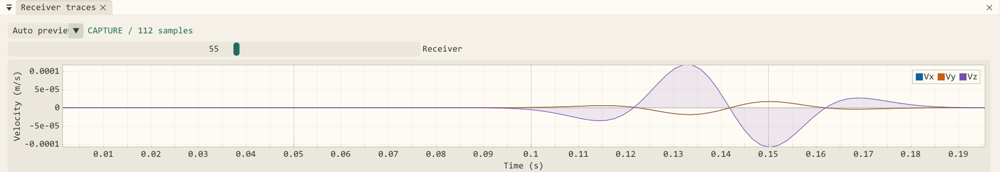

# CUDA加速3D弹性波模拟

## 摘要 (Abstract)

**SeisWave Lab**（当前版本 **v2.0.0**，源码工程 `CMakePro_CUDA_SeisSim_V2`）是一套基于 **C++20、NVIDIA CUDA 12.8、OpenGL 4.3 与 Dear ImGui Docking / ImPlot** 构建的交互式弹性波数值模拟软件。项目保留原有二维模拟管线，并通过独立的 **Seis3D** 子系统扩展三维各向同性弹性波正演、空间波场可视化与三分量地震数据采集。

Seis3D 将模型配置、GPU 有限差分求解、正交三剖面、半透明体绘制、接收波形和 SEG-Y 导出整合到统一工作区。用户可以配置分层介质与震源，在计算过程中观察空间传播，并将地表接收网格记录导出用于后续分析。

本文结合实际运行截图，介绍系统的计算方法、可视化设计和完整操作流程。当前版本面向**计算地球物理教学、波场传播理解与算法原型探索**；文中的大网格显存数值为代码预算估算。

<!-- more -->

---

## 1. 从二维波场走向三维空间

二维模拟便于观察单个剖面中的传播现象。扩展到三维后，模型增加了横向变化，震源、接收点与波场之间也具有更完整的空间关系。软件因此需要同时处理三维差分计算、显存开销、空间观察和多测线采集。

Seis3D 的设计目标，是让“建立模型—运行计算—观察波场—采集记录—导出数据”形成连贯的交互流程。



*图 1：实际程序首页。二维波场沙盒和三维空间探索沙盒拥有独立入口，右侧同时显示当前 CUDA 设备信息。*

当前版本主要提供以下能力：

| 方向 | 已实现功能 |
| --- | --- |
| 物理计算 | 三维各向同性速度—应力弹性波方程、八阶内部空间差分、二阶时间推进 |
| 边界处理 | 薄层记忆变量 CPML、平面顶部自由表面 |
| 模型与震源 | 均匀、分层与球形异常体配置，Ricker 爆炸源和定向体力源 |
| 波场观察 | 三正交剖面、联动拾取、滚轮缩放、辅助体绘制 |
| 工作区 | 可拖动停靠窗口、多种布局与界面主题 |
| 数据采集 | 最多 100 个接收点、Vx/Vy/Vz 三分量、单炮与矩形多测线放炮 |
| 文件交换 | `.s3dm` 三维物性模型、三分量 SEG-Y 与观测几何 CSV |

## 2. 计算与可视化如何连接

### 2.1 独立的三维模拟子系统

三维代码集中在 `namespace Seis3D` 中，以独立静态库组织。物理上下文、GPU 场指针、图形句柄和交互状态分别由 `SimulationContext3D`、`GPUSimData3D`、`GLHandles3D` 与 `Seis3D_State` 管理。

二维与三维各自维护模拟状态和 GPU / OpenGL 资源。返回首页切换模式时，原模式的计算和图形资源在目标模式分配前释放，降低两个大模型同时驻留显存的风险。

### 2.2 数据流

```text
物性模型 + 震源 + 观测系统
           ↓
输入检查 → 最大 Vp 扫描 → 安全时步与显存预算
           ↓
CUDA 速度—应力更新与边界处理
           ├─ 正交剖面 / 辅助显示体 → OpenGL → 交互视图
           └─ 接收点三分量采样 → 道集快照 → SEG-Y / CSV
```

CUDA 负责物理场推进和显示数据抽取，OpenGL 负责图像呈现，ImGui / ImPlot 组织参数、空间视图与曲线。主机代码采用 C++20，CUDA 编译单元采用 C++17，通过 CMake 管理构建与资源部署。

## 3. 三维弹性波计算方法

### 3.1 一阶速度—应力方程

在各向同性线弹性介质中，系统求解三个速度分量与六个独立应力分量：

$$
\mathbf{v}=(v_x,v_y,v_z),\qquad
\boldsymbol{\sigma}=
\begin{pmatrix}
\sigma_{xx}&\sigma_{xy}&\sigma_{xz}\\
\sigma_{xy}&\sigma_{yy}&\sigma_{yz}\\
\sigma_{xz}&\sigma_{yz}&\sigma_{zz}
\end{pmatrix}.
$$

忽略衰减时，控制方程可写为：

$$
\rho\frac{\partial\mathbf{v}}{\partial t}
=\nabla\cdot\boldsymbol{\sigma}+\mathbf{f},
$$

$$
\frac{\partial\boldsymbol{\sigma}}{\partial t}
=\lambda(\nabla\cdot\mathbf{v})\mathbf{I}
+\mu\left[\nabla\mathbf{v}+(\nabla\mathbf{v})^{\mathsf T}\right]
+\mathbf{Q}.
$$

其中，密度为 $\rho$，$\mathbf{f}$ 为体力源，$\mathbf{Q}$ 为应力率源项；各向同性爆炸源作用于三个法向应力。模型输入的纵横波速度与 Lamé 参数满足：

$$
\mu=\rho V_s^2,\qquad
\lambda=\rho(V_p^2-2V_s^2).
$$

### 3.2 交错网格与时间推进

内部空间导数采用**固定八阶交错网格差分**，每个方向使用八个采样点，三个方向形成 24 点十字邻域。时间采用二阶 leapfrog 推进，速度位于半时间步，应力位于整数时间步。

速度点采用面中心平均密度，剪切点采用调和平均剪切模量。震源使用 Ricker 子波和归一化的 3 × 3 × 3 空间分布，支持爆炸机制与定向体力机制。

### 3.3 CPML、自由表面与安全时步

外边界采用非分裂卷积完全匹配层（CPML），记忆变量只分配在对应方向的边界薄层，以控制三维辅助场的显存开销。启用顶部自由表面后，物理顶面 $z=0$ 满足零牵引力条件，顶部不再设置 Z 向 CPML。

**内部空间差分为八阶，当前平面自由表面的离散闭合为二阶。** 当前版本使用平面顶部，尚不支持起伏地形。

初始化或导入模型时，程序扫描最大纵波速度，并按下式约束时步：

$$
\Delta t_{\mathrm{safe}}
=\frac{\mathrm{CFL}\,\Delta x}
{\sqrt{3}\,V_{p,\max}\,S},
\qquad S=\sum_{m=1}^{4}|c_m|,
$$

其中 $c_m$ 为交错差分权重，默认安全系数为 0.85。实际时步向下量化到整数微秒；模型输入检查、显存检查与非有限波场检测共同为运行提供约束。

## 4. 可停靠的科学计算工作区



*图 2：96³ 双层模型的实际运行界面。模拟时间约 0.1453 s，计算到第 160 步，正式采集已有 80 个样本。*

三维页面使用 Dear ImGui Docking，将参数、显示设置、三剖面、体视图和接收曲线组织为可停靠窗口。

| 区域 | 作用 |
| --- | --- |
| 顶部工具栏 | 运行、暂停、单步、重置波场、发射并采集、切换工作区 |
| 参数面板 | Simulation、Source、Model I/O、Acquisition |
| 显示面板 | 分量、色带、材料物性、增益、透明度和显示预设 |
| 中央视图区 | Inline、Crossline、Depth 与 Spatial volume |
| 底部 | 接收曲线、格点与物理坐标、物性和运行提示 |

用户可以拖动标签、拆分窗口、合并标签页和调整比例。工作区提供 **Four views、Volume focus、Compact / tabbed** 三种预设，分别适合多剖面对照、整体空间观察和较小屏幕。

顶部同时显示计算时间、步数、剖面位置、显存与界面帧率。界面 FPS 受计算批次和显示更新频率影响，需要与求解器吞吐率区分。

## 5. 正交剖面与空间观察

### 5.1 三个互相联动的剖面



*图 3：Inline 剖面。浅色背景呈现双层材料，波场叠加其上，坐标标尺以米为单位。*

| 视图 | 固定坐标 | 展示平面 |
| --- | --- | --- |
| Inline | Y | X–Z |
| Crossline | X | Y–Z |
| Depth slice | Z | X–Y |

三个剖面使用完整物理网格，Z 轴表示向下增加的深度。滚轮围绕鼠标位置缩放，范围为 **100%–3200%**；中键拖动平移，左键单击拾取格点并联动剖面。网格、交叉线、震源和接收点标记使用同一坐标变换。

每个剖面可单独 Reset view，顶部 Reset views 或快捷键 R 则恢复全部视图。鼠标拾取同时反馈 XYZ、米制坐标及 Vp、Vs、密度，便于将波场变化与模型结构对应起来。

### 5.2 辅助体绘制



*图 4：辅助体视图与物理模型包围盒。左键旋转、右键或滚轮缩放、中键平移。*

体视图采用 raymarching 呈现半透明波场，适合观察整体传播形态及震源与波前的空间关系。辅助显示体每轴最多 256 点，按体素中心三线性重采样；输出随视口尺寸调整，最长边 1536 像素，射线根据体素路径使用 192–1024 点采样。采样密度与波前锐度可单独调节。

细薄层、细小高频波前和定量振幅应结合完整分辨率剖面与接收记录分析。体视图的采样分辨率独立于物理求解网格。

## 6. Paper 风格与波场显示

本文截图统一使用 **Paper Sand 界面主题 + Paper scientific 显示预设**。暖白画布、深灰文字、青绿色控件与浅色材料分层配合 Coolwarm 蓝红波场，使模型和波场在文章截图中保持清晰。



*图 5：界面主题、波场色带与材料显示分别控制，可按观察任务调整。*

系统提供八套界面主题，包括 CUDA Green、Ocean Blue、Graphite、Scientific Light、Midnight Violet、Teal Studio、Amber Lab 和 Paper Sand。波场另提供 Coolwarm、Seismic Bipolar、Viridis、Turbo 等配色，以及五套显示预设。

显示模式可切换为：

- **Model + wavefield**：物性模型与波场叠加，便于观察分层响应。
- **Wavefield only**：集中观察传播形态。
- **Material only**：检查 Vp、Vs 或密度结构。

首次观察建议使用 **Velocity magnitude**，避免单分量在对称剖面上接近零。速度幅值是非负量，此时蓝红表示幅值大小；需要研究正负极性时，应选择带符号的 Vx、Vy 或 Vz。

增益、透明度、弱波可见度和阈值只改变显示映射，采集数据仍保留物理单位。跨时刻比较振幅时，应使用一致的手动显示尺度，避免自动缩放影响视觉判断。

## 7. 从 100 个接收点到三分量道集



*图 6：实际接收曲线。横轴为时间（s），纵轴为质点速度（m/s），可切换接收点和预览来源。*

### 7.1 接收网格与实时预览

接收系统默认采用 **10 × 10 = 100 个接收点**，当前总上限为 100。可以设置 XYZ 原点、XY 点数、间距和接收深度；Z=0 对应地表。Fit spread to model 用于适配模型范围，Deploy mesh 应用观测几何。

每个接收点同时记录 Vx、Vy、Vz。普通 Run 按计算批次生成 Live 预览，每道保留最近 1000 个点，便于观察信号是否到达。正式采集按指定 Sample stride 均匀抽取，保存独立 CPU 道集快照。

Live 预览与正式道集采用不同采样方式。需要导出时，应使用 **Fire + capture** 或 **Capture current source**，并在 Captured 模式检查记录。

### 7.2 采样与 SEG-Y 导出

正式采样间隔满足：

$$
\Delta t_{\mathrm{sample}}=\mathrm{stride}\times\Delta t.
$$

例如示例模型的时步为 0.908 ms，stride=2 时采样间隔为 1.816 ms。由于速度采用半时间步，准确首样本时间也随几何 CSV 保存。

每炮导出以下四类文件：

```text
shot_..._vx.sgy        X 分量速度道集
shot_..._vy.sgy        Y 分量速度道集
shot_..._vz.sgy        Z 分量速度道集
shot_..._geometry.csv  源检几何与采样信息
```

三个分量分别保存，每个 SEG-Y 文件最多 100 道。导出采用 SEG-Y rev1 文件结构、大端 IEEE float32 样本，并写入源检坐标、分量标识及 CMP Inline / Crossline 分箱标号。矩形多测线震源可逐炮重置、采集和自动导出。

当前坐标采用局部直角坐标加世界原点偏移；CMP 分箱标号用于描述几何，当前尚未实现投影转换、CMP 叠加或偏移成像。

## 8. 快速复现一个示例

| 参数 | 设置 |
| --- | --- |
| 物理网格 | 96 × 96 × 96 |
| 网格间距 | 10 m |
| 模型 | Two layers |
| CPML 厚度 | 12 格 |
| 顶部自由表面 | 开启 |
| Ricker 主频 | 20 Hz |
| CFL 安全系数 | 0.85 |
| 接收网格 | 10 × 10，共 100 点 |
| 外观 | Paper Sand + Paper scientific |

1. 首页进入三维沙盒，在 Simulation 中配置上述参数。
2. 点击 Initialize 3D；已有会话时点击 Rebuild 3D session。
3. 在 Display / materials 中选择浅色主题和 Paper scientific 预设。
4. 点击 Run，等待子波起振和传播，观察三个剖面与 Live 曲线。
5. Pause 后通过滚轮、拾取和轨道相机检查空间波场。
6. 在 Acquisition 中配置并 Deploy mesh，设置样本数、采样步距和导出目录。
7. 点击 Fire + capture，采集完成后导出三分量 SEG-Y。

模型可保存为 `.s3dm` 文件，包含物理网格的 Vp、Vs 和密度。导入后重新检查物性、计算最大 Vp 并同步安全时步；CPML 与差分保护区由程序重建。

## 9. 显存预算与运行范围

三维网格随尺寸增长带来显著的内存需求。Seis3D 使用薄层 CPML、独立资源生命周期和受限辅助显示体控制开销，分配前查询实际剩余显存并保留余量。

下表来自当前代码预算，条件为 **12 格 CPML、自由表面开启**，包含填充后的物理场、材料、CPML 与显示缓冲：

| 物理网格 | 预计总预算 |
| --- | ---: |
| 96³ | 0.140 GiB |
| 160³ | 0.443 GiB |
| 300³ | 1.987 GiB |
| 300 × 300 × 400 | 2.516 GiB |

**这些数值不是实测显存峰值或性能基准。** 驱动、CUDA 模块和其他应用另有占用；大网格的运行速度还受 GPU、显示更新频率和体绘制设置影响。当前单次预算上限为 4 GiB，建议从 96³ 开始逐级增加尺寸。

本文截图运行于 NVIDIA GeForce RTX 4060 Laptop GPU（8 GB）。实际展示为 96³ 模型，不能据此推断所有大网格都具有相同交互速度。

## 10. 当前阶段与后续方向

当前版本已经形成模型配置、三维计算、空间观察、三分量采集和数据导出的完整交互流程，并已有显示、采集、交互与资源释放的集成检查。

用于定量地震研究前，还需要系统开展 P/S 波到时、网格收敛性、自由表面响应、CPML 斜入射与角点反射、长时间稳定性及第三方 SEG-Y 兼容性验证。

后续迭代将围绕三条方向展开：

- **数值验证**：建立可重复的解析解与参考解对照，明确误差、边界反射和适用频率范围。
- **计算与交互**：在有测量依据的前提下优化 CUDA 核函数、显示抽取与大模型工作流。
- **数据与模型**：完善后台 I/O、采集分析和更复杂介质的扩展接口。

Seis3D 为三维地震波传播提供了可直接操作的观察环境，也为后续算法开发保留了相对独立的求解、渲染和采集模块。

---

**项目源码：** [CMakePro_CUDA_SeisSim_V2](https://github.com/XiaoYu-1111/CMakePro_CUDA_SeisSim_V2)

本文根据项目的 Seis3D_User_Guide 与当前实现说明整理，内容更新于 2026 年 10 月 12 日。全部插图来自实际程序运行截图，局部图仅裁切，未重新绘制波场或修改采集数据。
