# CUDA加速3D弹性波模拟

## 摘要 (Abstract)

**SeisWave Lab**（当前版本 **v2.0.0**，源码工程 `CMakePro_CUDA_SeisSim_V2`）是一套基于 **C++20、NVIDIA CUDA 12.8、OpenGL 4.3 与 Dear ImGui Docking / ImPlot** 构建的交互式弹性波数值模拟软件。项目保留原有二维模拟管线，并通过独立的 **Seis3D** 子系统扩展三维各向同性弹性波正演、空间波场可视化与三分量地震数据采集。

Seis3D 将模型配置、GPU 有限差分求解、正交三剖面、半透明体绘制、接收波形和 SEG-Y 导出整合到统一工作区。用户可以配置分层介质与震源，在计算过程中观察空间传播，并将地表接收网格记录导出用于后续分析。

本文结合实际运行截图，介绍系统的计算方法、可视化设计和完整操作流程。当前版本面向**计算地球物理教学、波场传播理解与算法原型探索**；文中的大网格显存数值为代码预算估算。

**当前初始参数：** 300 × 50 × 300 物理网格；X 向每排 50 道、Y 向 3 排，共 150 个接收点，总上限 300 道；每炮 1000 样点、每 2 个计算步采样一次。初始显示为 **Vz + Geological layers + Coolwarm**，历史峰值保持关闭。默认采用自动 CFL 安全步长，也可在安全范围内手动设置 0.5 ms 等整数微秒步长。

本文截图重新采自当前版本：200³双层模型、10m网格、20Hz、0.5ms手动步长、50×3地表接收阵列。全部图片保留原生2560×1494完整窗口，不裁切、不拉伸，不提高界面文字倍率；六种波场色带比较冻结于第480步（0.240s）。软件普通默认参数与本次演示参数分别说明。

<!-- more -->

---

## 1. 从二维波场走向三维空间

二维模拟便于观察单个剖面中的传播现象。扩展到三维后，模型增加了横向变化，震源、接收点与波场之间也具有更完整的空间关系。软件因此需要同时处理三维差分计算、显存开销、空间观察和多测线采集。

Seis3D 的设计目标，是让“建立模型—运行计算—观察波场—采集记录—导出数据”形成连贯的交互流程。

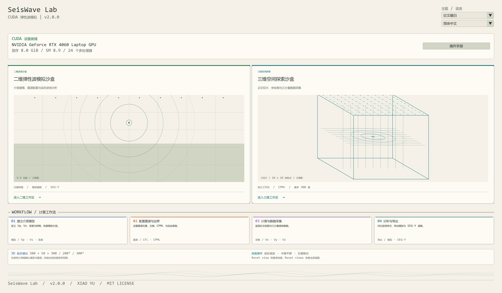

*图1：当前版本Paper Sand首页，提供二维、三维独立入口，并提供设备摘要、界面主题、中英文切换及操作手册入口。首页 10 × 10 接收点图案是空间示意，不代表求解器默认采集排列。*

当前版本主要提供以下能力：

| 方向 | 已实现功能 |
| --- | --- |
| 物理计算 | 三维各向同性速度—应力弹性波方程、八阶内部空间差分、二阶时间推进 |
| 边界处理 | 自由顶面与五面 CPML、六面全吸收、六面全反射，以及独立边界显示 |
| 模型与震源 | 九种合成模型预设，Ricker 爆炸源和定向体力源，主频显式应用 |
| 波场观察 | 三正交剖面、联动拾取、滚轮缩放、辅助体绘制 |
| 工作区 | 四种停靠布局、十套界面主题、中英文切换、分组折叠与快捷键 |
| 数据采集 | 默认 150 个接收点、最多 300 道、Vx/Vy/Vz 三分量、单炮与矩形多测线放炮 |
| 记录分析 | 每道最近 1000 点实时预览、单道与接收选行、AGC、时间轴与道轴缩放、六种记录样式 |
| 文件交换 | `.s3dm` 模型导入导出、三分量 SEG-Y 与几何 CSV、外部单炮 SEG-Y 导入显示 |

## 2. 计算与可视化如何连接

### 2.1 独立的三维模拟子系统

三维代码集中在 `namespace Seis3D` 中，以独立静态库组织。物理上下文、GPU 场指针、图形句柄和交互状态分别由 `SimulationContext3D`、`GPUSimData3D`、`GLHandles3D` 与 `Seis3D_State` 管理。

二维与三维各自维护模拟状态和 GPU / OpenGL 资源。返回首页切换模式时，原模式的计算和图形资源在目标模式分配前释放，降低两个大模型同时驻留显存的风险。

### 2.2 数据流

```text
物性模型 + 震源 + 观测系统
           ↓
输入检查 → 最大 Vp 扫描 → 安全时步与显存预算
           ↓
CUDA 速度—应力更新与边界处理
           ├─ 正交剖面 / 辅助显示体 → OpenGL → 交互视图
           └─ 接收点三分量采样 → 道集快照 → SEG-Y / CSV
```

CUDA 负责物理场推进和显示数据抽取，OpenGL 负责图像呈现，ImGui / ImPlot 组织参数、空间视图与曲线。主机代码采用 C++20，CUDA 编译单元采用 C++17，通过 CMake 管理构建与资源部署。

### 2.3 技术栈与 CUDA 并行设计

| 技术 | 在软件中的作用 |
| --- | --- |
| C++20 / CUDA C++17 | 会话状态、文件读写与数值核函数 |
| NVIDIA CUDA 12.8 | 三维格点差分、CPML、物性生成、显示抽取与接收采样 |
| OpenGL 4.3 | 切片纹理、离屏绘制、半透明体绘制及 CUDA/GL 互操作 |
| Dear ImGui Docking | 参数面板、停靠布局、主题、双语和交互控件 |
| ImPlot | 单道／多道地震记录、密度图、缩放与平移 |
| CMake / MSVC | 模块化编译与运行资源部署，产物统一进入外层 out |

三维差分更新需要在大量格点上重复执行相近的邻域运算。CUDA 将格点任务分配给 GPU 线程并行处理，利用显卡的计算吞吐与内存带宽；速度、应力和边界更新按求解顺序在专用计算流中执行，保留交错时间推进所需的依赖关系。

程序通过 CUDA/OpenGL 共享缓冲交换波场与材料显示数据，避免每次显示先回传完整三维体到 CPU 再上传。CPML 记忆变量只分配在边界薄层，显示体尺寸与求解网格分开约束；大模型还可降低显示更新频率，使资源更多用于数值推进。

这些设计适合三维波场计算和交互观察。实际速度仍取决于 GPU、网格、边界厚度和显示设置；当前文章未给出经统一实验测得的 CPU/GPU 加速比，也不以界面 FPS 代替求解吞吐率。

## 3. 三维弹性波计算方法

### 3.1 一阶速度—应力方程

在各向同性线弹性介质中，系统求解三个速度分量与六个独立应力分量：

$$
\mathbf{v}=(v_x,v_y,v_z),\qquad
\boldsymbol{\sigma}=
\begin{pmatrix}
\sigma_{xx}&\sigma_{xy}&\sigma_{xz}\\
\sigma_{xy}&\sigma_{yy}&\sigma_{yz}\\
\sigma_{xz}&\sigma_{yz}&\sigma_{zz}
\end{pmatrix}.
$$

忽略衰减时，控制方程可写为：

$$
\rho\frac{\partial\mathbf{v}}{\partial t}
=\nabla\cdot\boldsymbol{\sigma}+\mathbf{f},
$$

$$
\frac{\partial\boldsymbol{\sigma}}{\partial t}
=\lambda(\nabla\cdot\mathbf{v})\mathbf{I}
+\mu\left[\nabla\mathbf{v}+(\nabla\mathbf{v})^{\mathsf T}\right]
+\mathbf{Q}.
$$

其中，密度为 $\rho$，$\mathbf{f}$ 为体力源，$\mathbf{Q}$ 为应力率源项；各向同性爆炸源作用于三个法向应力。模型输入的纵横波速度与 Lamé 参数满足：

$$
\mu=\rho V_s^2,\qquad
\lambda=\rho(V_p^2-2V_s^2).
$$

### 3.2 交错网格与时间推进

内部空间导数采用**固定八阶交错网格差分**，每个方向使用八个采样点，三个方向形成 24 点十字邻域。时间采用二阶 leapfrog 推进，速度位于半时间步，应力位于整数时间步。

速度点采用面中心平均密度，剪切点采用调和平均剪切模量。震源使用 Ricker 子波和归一化的 3 × 3 × 3 空间分布，支持爆炸机制与定向体力机制。

### 3.3 CPML、自由表面与安全时步

外边界采用非分裂卷积完全匹配层（CPML），记忆变量只分配在对应方向的边界薄层，以控制三维辅助场的显存开销。启用顶部自由表面后，物理顶面 $z=0$ 满足零牵引力条件，顶部不再设置 Z 向 CPML。

| 边界模式 | 实际物理条件 |
| --- | --- |
| Free top + CPML | 顶部零牵引力自由表面，其他五面 CPML 吸收 |
| All absorbing (6-face CPML) | 包括顶面在内的六面 CPML，有限厚度仍可能有残余反射 |
| All reflecting (slip walls) | 六面无损滑移反射墙：法向速度为零、切向牵引力为零；停用 CPML |

**Show boundary layers / walls** 或 B 键只控制边界区域是否显示，不能替代物理边界模式切换；改变边界模式或厚度后需要重建会话。

**内部空间差分为八阶，当前平面自由表面的离散闭合为二阶。** 当前版本使用平面顶部，尚不支持起伏地形。

初始化或导入模型时，程序扫描最大纵波速度，并按下式约束时步：

$$
\Delta t_{\mathrm{safe}}
=\frac{\mathrm{CFL}\,\Delta x}
{\sqrt{3}\,V_{p,\max}\,S},
\qquad S=\sum_{m=1}^{4}|c_m|,
$$

其中 $c_m$ 为交错差分权重，默认安全系数为 0.85。自动模式将安全上限向下量化到整数微秒；模型输入检查、显存检查与非有限波场检测共同为运行提供约束。

在 **Simulation → TIME / STABILITY** 可切换 **Automatic CFL / Manual (ms)**。手动步长以 0.001 ms 为单位，必须不超过当前模型的安全上限，超限会拒绝初始化。默认双层模型的自动步长约为 0.908 ms，可以手动设为 0.5 ms；1 ms 对该默认模型不安全。修改步长后点击 **Rebuild 3D session** 生效，并重新生成 CPML 系数；运行和采集使用已生效步长，不直接读取待应用输入。

主频修改也区分待应用与已生效值。**Apply frequency + reset fields**、重发震源或新采集会同步更新 Ricker 子波和 CPML 频率系数，保留模型及显示增益；普通 Run 继续当前波场。界面显示每周期计算步数、记录采样间隔与时长，便于检查时间分辨率。


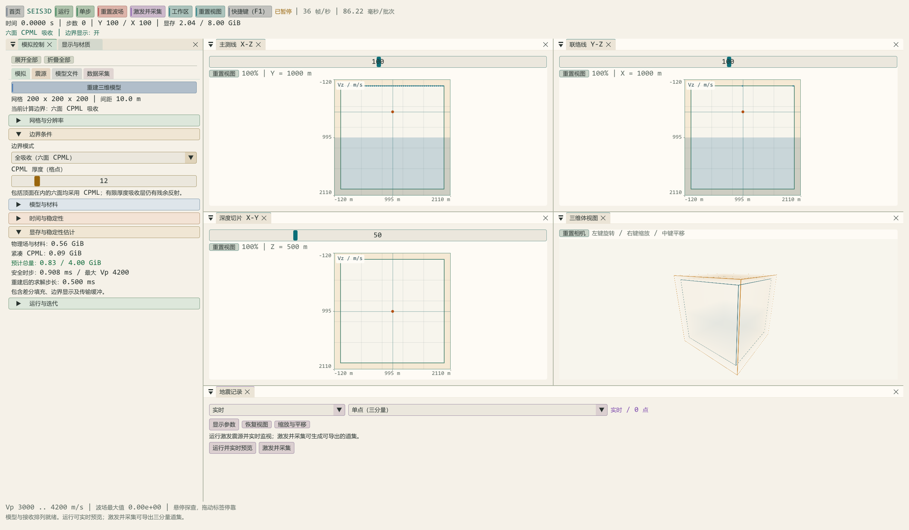


这些边界图片展示模式设置与初始化结果，不构成新的定量反射误差验证。

### 3.4 常见模型预设

| 预设 | 结构 |
| --- | --- |
| Uniform | 均匀介质 |
| Two layers | 水平双层 |
| Sphere anomaly | 球形／椭球形异常体 |
| Three layers | 三层介质 |
| Dipping interface | 沿 X 倾斜的界面 |
| Low-velocity interbed | 低速夹层 |
| Faulted interface | 错断界面 |
| Depth velocity gradient | 随深度变化的速度梯度 |
| Salt dome | 合成高速盐丘 |

模型预设载入材料与几何默认值，保留网格、边界及步长选择；点击重建后生效。界面可分别设置背景与第二介质的 Vp、Vs、密度，以及界面深度、倾角、夹层厚度、断距或异常半径。


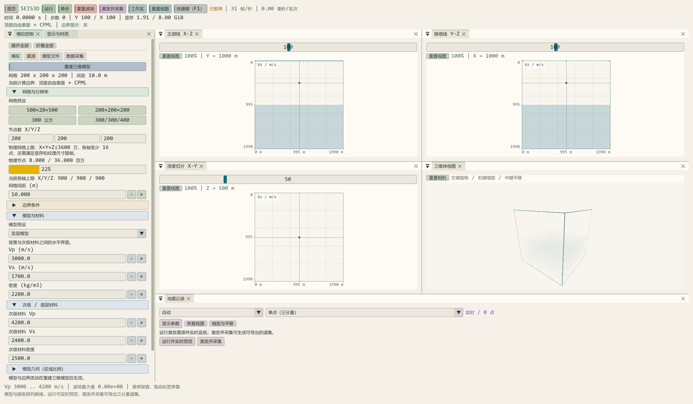


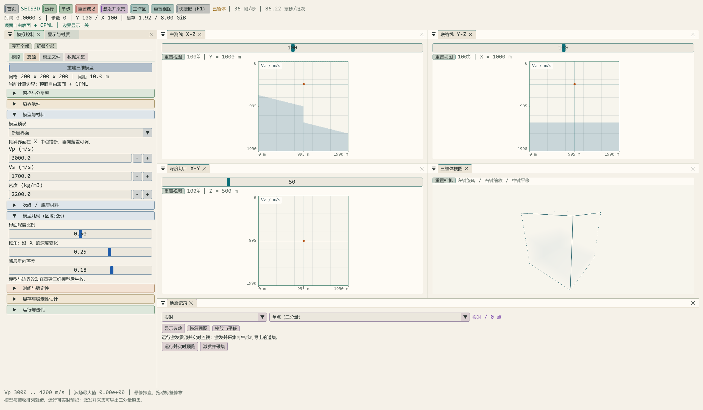


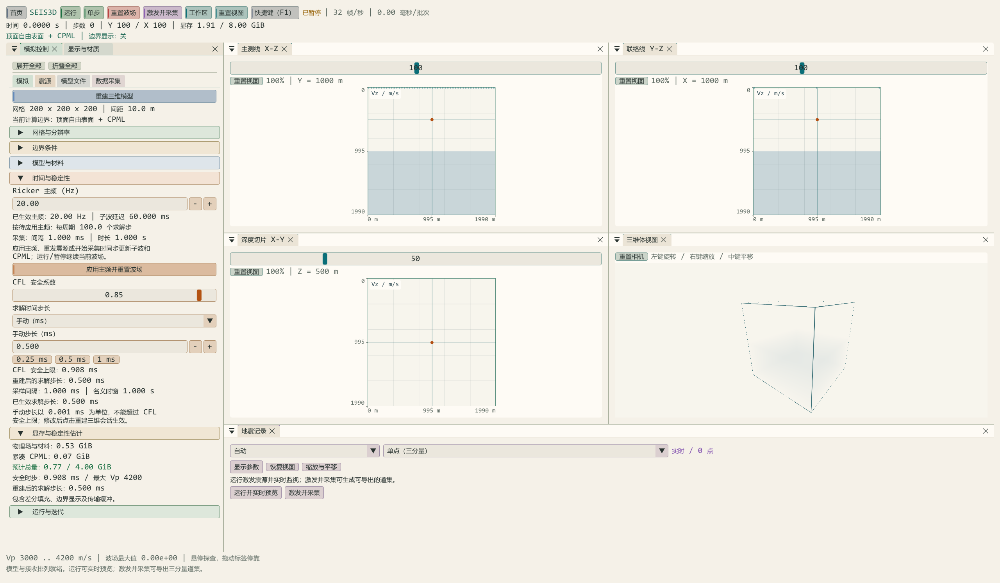


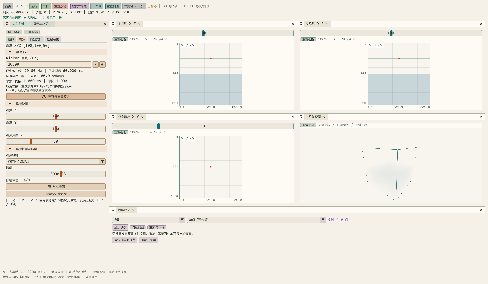

## 4. 可停靠的科学计算工作区

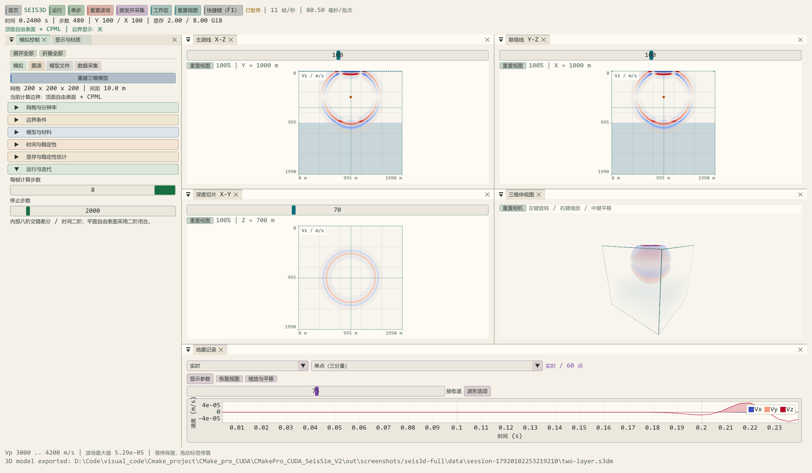

*图2：200³双层模型，第480步、0.240s的真实Vz波场与Live预览。显示增益1.8；深度切片为Z=70格（700m），避开震源对称面。*

三维页面使用 Dear ImGui Docking，将参数、显示设置、三剖面、体视图和接收曲线组织为可停靠窗口。

| 区域 | 作用 |
| --- | --- |
| 顶部工具栏 | 运行、暂停、单步、重置波场、发射并采集、切换工作区 |
| 参数面板 | Simulation、Source、Model I/O、Acquisition |
| 显示面板 | 分量、色带、材料物性、增益、透明度和显示预设 |
| 中央视图区 | Inline、Crossline、Depth 与 Spatial volume |
| 底部 | 接收曲线、格点与物理坐标、物性和运行提示 |

用户可以拖动标签、拆分窗口、合并标签页和调整比例。工作区提供 **Four views、Volume focus、Compact / tabbed、Receiver focus** 四种预设，分别适合多剖面对照、空间观察、小屏幕和地震记录分析。参数与显示设置分组可单独展开／收起；**Expand all / Collapse all** 作用于当前显示的标签页，保留物理参数、增益和色带。文字尺寸可独立调整。

顶部同时显示计算时间、步数、剖面位置、显存与界面帧率。界面 FPS 受计算批次和显示更新频率影响，需要与求解器吞吐率区分。

## 5. 正交剖面与空间观察

### 5.1 三个互相联动的剖面

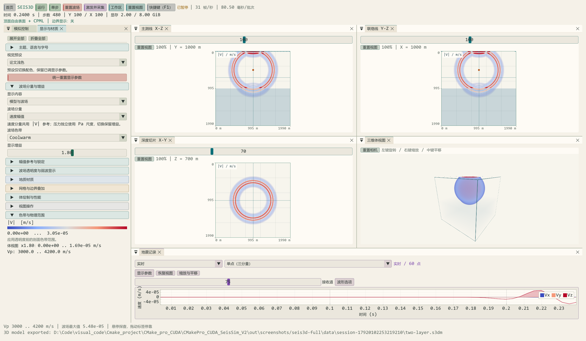

*图3：完整工作区中的三正交剖面，切换到速度幅值，剖面保持100%适配。浅色背景呈现材料分层，坐标以米为单位。*

| 视图 | 固定坐标 | 展示平面 |
| --- | --- | --- |
| Inline | Y | X–Z |
| Crossline | X | Y–Z |
| Depth slice | Z | X–Y |

三个剖面使用完整物理网格，Z 轴表示向下增加的深度。滚轮围绕鼠标位置缩放，范围为 **100%–3200%**；中键拖动平移，左键单击拾取格点并联动剖面。网格、交叉线、震源和接收点标记使用同一坐标变换。

每个剖面可单独 Reset view，顶部 Reset views 或快捷键 R 则恢复全部视图。鼠标拾取同时反馈 XYZ、米制坐标及 Vp、Vs、密度，便于将波场变化与模型结构对应起来。

### 5.2 辅助体绘制

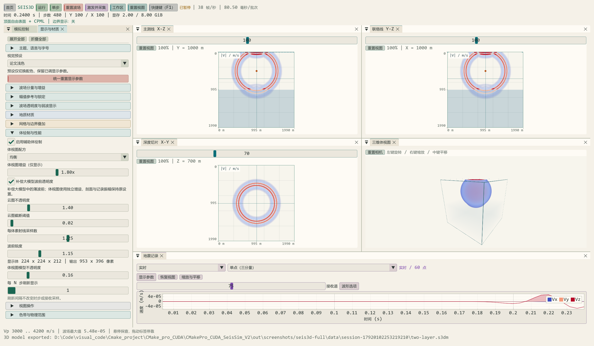

*图 4：辅助体视图与物理模型包围盒。左键旋转、右键或滚轮缩放、中键平移。*

体视图采用 raymarching 呈现半透明波场，适合观察整体传播形态及震源与波前的空间关系。辅助显示体每轴最多 256 点，按体素中心三线性重采样；输出随视口尺寸调整，最长边 1536 像素，射线根据体素路径使用 192–1024 点采样。采样密度与波前锐度可单独调节。

细薄层、细小高频波前和定量振幅应结合完整分辨率剖面与接收记录分析。体视图的采样分辨率独立于物理求解网格。

## 6. Paper 风格与波场显示

本文截图统一使用 **Paper Sand 界面主题 + Paper scientific 显示预设**。暖白画布、深灰文字、青绿色控件与浅色材料分层配合 Coolwarm 蓝红波场，使模型和波场在文章截图中保持清晰。


*图 5：界面主题、波场色带与材料显示分别控制，可按观察任务调整。*

系统提供十套界面主题：**CUDA Green、Ocean Blue、Graphite、Scientific Light、Midnight Violet、Teal Studio、Amber Lab、Paper Sand、Arctic Lab、Warm Ivory**。Scientific Light、Paper Sand、Arctic Lab 与 Warm Ivory 为浅色主题。首页和工作区支持英文／简体中文切换，语言和主题改变保留模拟及显示参数。

波场提供十四套色带，包括 Seismic Bipolar、Coolwarm、PuOr、Grayscale、Inferno、Plasma、Viridis、Turbo、Magma Glow、Jet Rainbow、Hot、Cold、Terrain Map、CUDA Green；材料背景有五套配色。五种视觉预设为 Wavefront contrast、Signed seismic、Geological layers、CUDA glow、Paper scientific。

**Visual preset 只切换配色，不恢复用户调好的显示增益、透明度或体绘制参数。** 需要统一恢复时，使用 **Reset display parameters**。初始分量为 Vz，初始预设为 Geological layers，波场为 Coolwarm，Hold observed peak 关闭；Paper scientific是本文截图采用的演示配色；演示先明确重置显示参数，再选择Vz和1.8倍增益。

显示模式可切换为：

- **Model + wavefield**：物性模型与波场叠加，便于观察分层响应。
- **Wavefield only**：集中观察传播形态。
- **Material only**：检查 Vp、Vs 或密度结构。

若某个分量在对称剖面上接近零，可切换 **Velocity magnitude** 查看整体波前。速度幅值是非负量，此时蓝红表示幅值大小；研究正负极性时，应选择带符号的 Vx、Vy 或 Vz。

增益、透明度、弱波可见度和阈值只改变显示映射，采集数据仍保留物理单位。跨时刻比较振幅时，应使用一致的手动显示尺度，避免自动缩放影响视觉判断。

Vz、Vx、Vy 与速度模共用速度幅值参考，压力使用独立 Pa 尺度；切换分量保留显示增益，避免尺度被重复清零。模型重建和重发震源会重启统计，已调增益与固定幅值尺度仍保留。体绘制的 **Volume gain**、透明度、波前锐度和采样密度独立调整；默认开启 **Size-consistent wave opacity**，补偿大模型中薄波前的透明度下降。

### 同一时刻的波场色带对照

下列完整窗口只改变波场色带：Vz、第480步、0.240s、1.8倍增益和相同材料背景。发散色带便于区分极性；渐变色带需要结合色标解读强弱，颜色切换不改变数值计算或采集振幅。


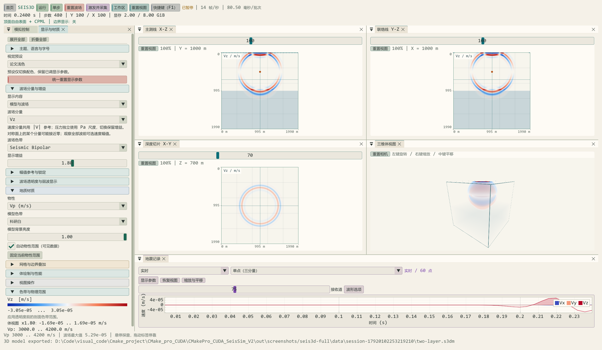


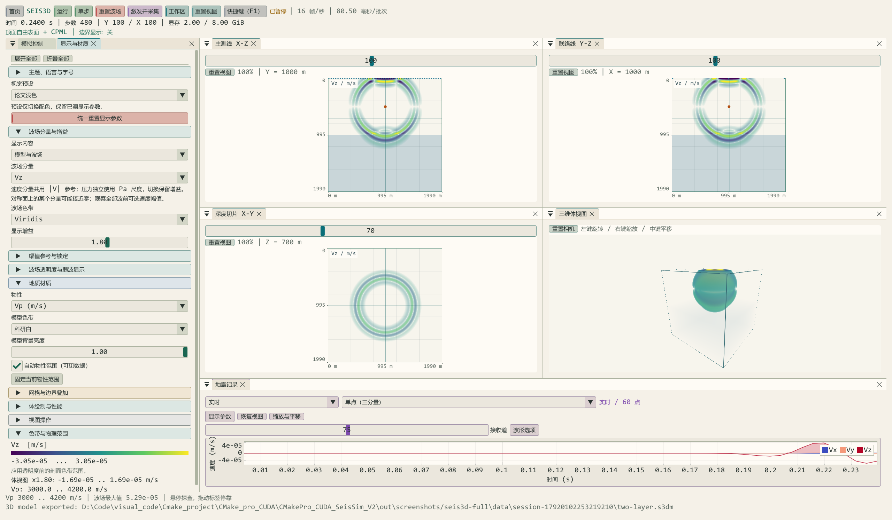


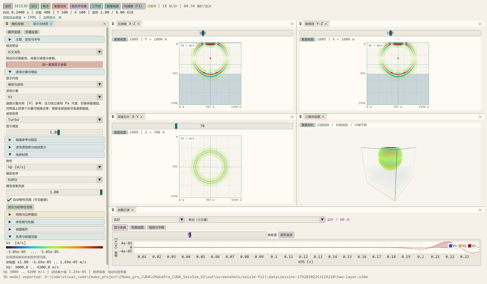


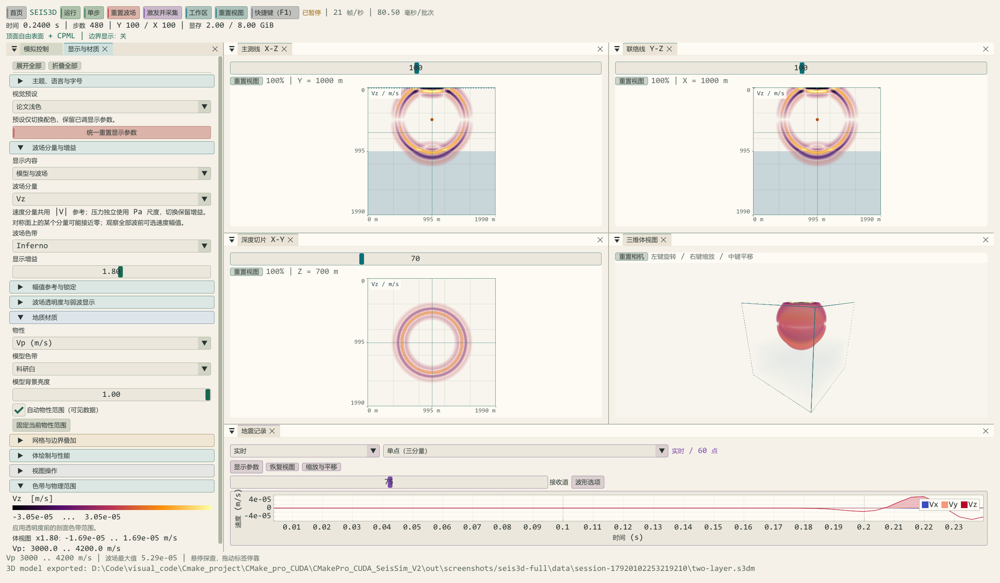


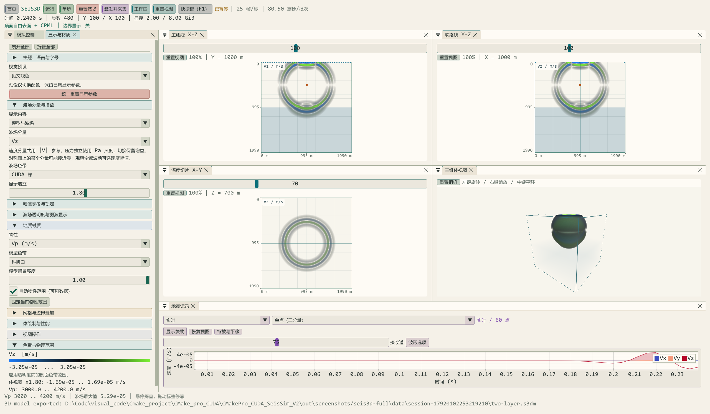

### 6.1 常用快捷键

| 按键 | 操作 |
| --- | --- |
| Q / Shift+Q | 下一个／上一个波场色带 |
| W / Shift+W | 下一个／上一个波场分量 |
| E / Shift+E | 下一个／上一个模型色带 |
| Space / N | 运行或暂停／单步计算 |
| C / R | 重置波场并暂停／恢复三剖面与相机 |
| G / B / V | 切换网格／边界层显示／辅助体绘制 |
| F1 | 打开中英文快捷键帮助 |
| Tab | 返回首页并释放该模式资源 |

二维与三维的 Q/W/E 顺序一致。编辑控件和打开弹窗时暂停快捷键；Ctrl/Alt 等组合不会触发工作区动作。三维采集或多炮序列期间 C 被禁用，显示项仍可切换。显示切换不更改记录原始振幅。


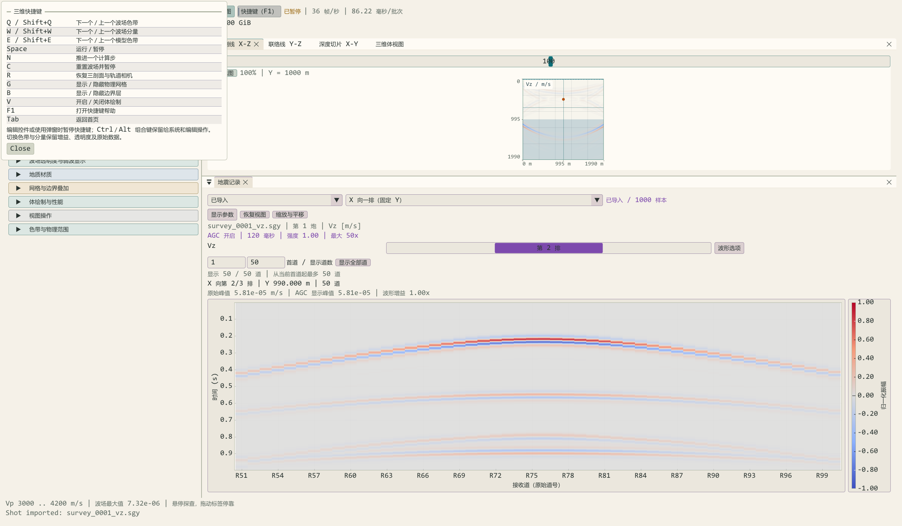

## 7. 从接收网格到三分量道集

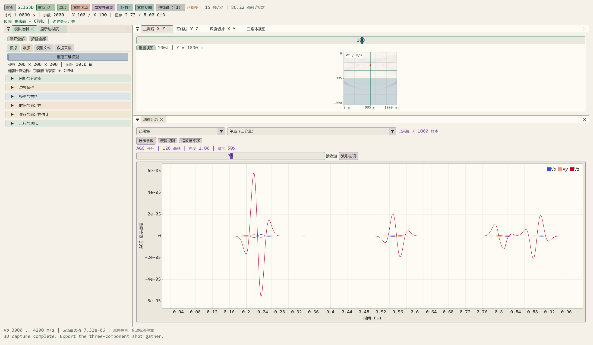

*图6：实际接收三分量曲线。截图开启AGC，纵轴为AGC显示振幅；关闭后按m/s显示物理振幅。横轴为时间（s），可切换接收点和数据来源。*

### 7.1 接收网格与实时预览

接收系统默认采用 **X 向每排 50 道、Y 向 3 排，共 150 个接收点**，总上限为 **300 道**。预设包括 50 × 3、50 × 6、10 × 10、20 × 5、5 × 20，以及单排 X/Y 测线。可以设置 XYZ 原点、XY 点数、间距和接收深度；Z=0 对应地表。Fit spread to model 适配并居中排列，Deploy mesh 应用观测几何；较小网格会减少可布设的实际数量。

默认 300 × 50 × 300 模型中，X=27+5i（i=0…49），Y=1/24/47，Z=0。选择单排 X 测线时放在 Y 中间；主页 10 × 10 示意与实际接收配置独立。

每个接收点同时记录 Vx、Vy、Vz。普通 Run 按计算批次生成 Live 预览，每道保留最近 1000 个点，便于观察信号是否到达。正式采集按指定 Sample stride 均匀抽取，保存独立 CPU 道集快照。

Live 预览与正式道集采用不同采样方式。需要导出时，应使用 **Fire + capture** 或 **Capture current source**，并在 Captured 模式检查记录。


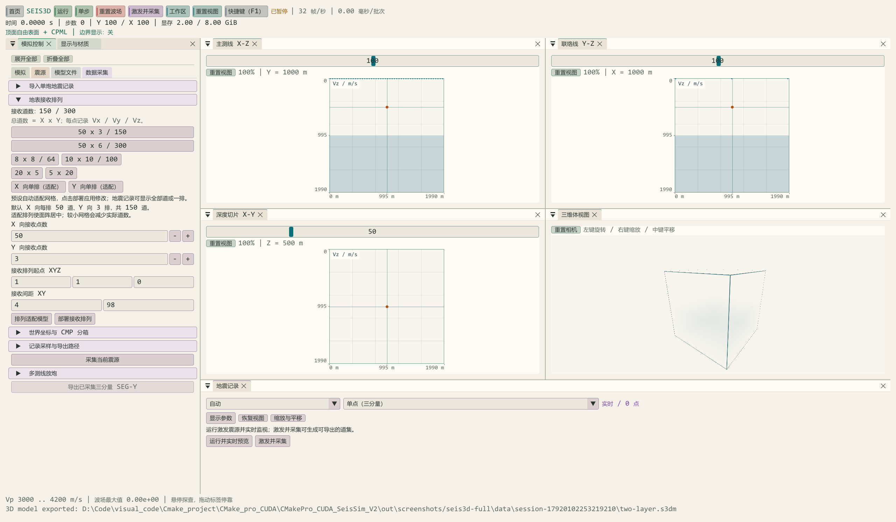

### 7.2 采样与 SEG-Y 导出

正式采样间隔满足：

$$
\Delta t_{\mathrm{sample}}=\mathrm{stride}\times\Delta t.
$$

默认每炮 **1000 样点**、stride=2。自动时步约 0.908 ms 时，采样间隔为 1.816 ms；希望获得整齐的记录间隔，可在 CFL 上限内手动设为 0.5 ms，此时每 2 步采样得到 1 ms 间隔。

| 求解步长 | 采样步数 stride | 记录间隔 | 1000 样点名义时窗 |
| --- | --- | --- | --- |
| 自动，默认模型约 0.908 ms | 2 | 1.816 ms | 1.816 s |
| 手动 0.5 ms | 2 | 1 ms | 1 s |
| 手动 0.25 ms | 4 | 1 ms | 1 s |

名义时窗为 `N × 记录间隔`，首末样点的实际跨度为 `(N−1) × 记录间隔`。速度采用半时间步，首样点位于 `(stride−0.5) × 求解步长`；0.5 ms、stride=2、1000 样点时，记录从 **0.75 ms 到 999.75 ms**。查看器和几何 CSV 保留真实起点，不人为把半时间步采样移到 0 s。

每炮最多 32767 样点，实际采样间隔最多 32.767 ms，三分量 CPU 道集缓冲上限为 512 MiB。修改求解步长需要重建，正式采集冻结自身模型、震源、接收几何和时步。

每炮导出以下四类文件：

```text
survey_0001_vx.sgy        X 分量速度道集
survey_0001_vy.sgy        Y 分量速度道集
survey_0001_vz.sgy        Z 分量速度道集
survey_0001_geometry.csv  源检几何与采样信息
```

三个分量分别保存，每个 SEG-Y 文件最多 **300 道**；三分量不计为三倍空间接收点。导出采用 SEG-Y rev1 文件结构、大端 IEEE float32 样本，并写入源检坐标、分量标识及 CMP Inline / Crossline 分箱标号。可浏览输出文件夹、选择文件名前缀或保存位置，也可为每次采集建立独立子目录；已有文件不覆盖。矩形多测线震源可逐炮重置、采集和自动导出。

当前坐标采用局部直角坐标加世界原点偏移；CMP 分箱标号用于描述几何，当前尚未实现投影转换、CMP 叠加或偏移成像。


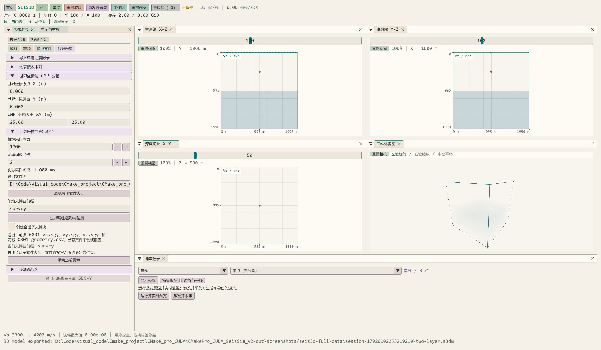


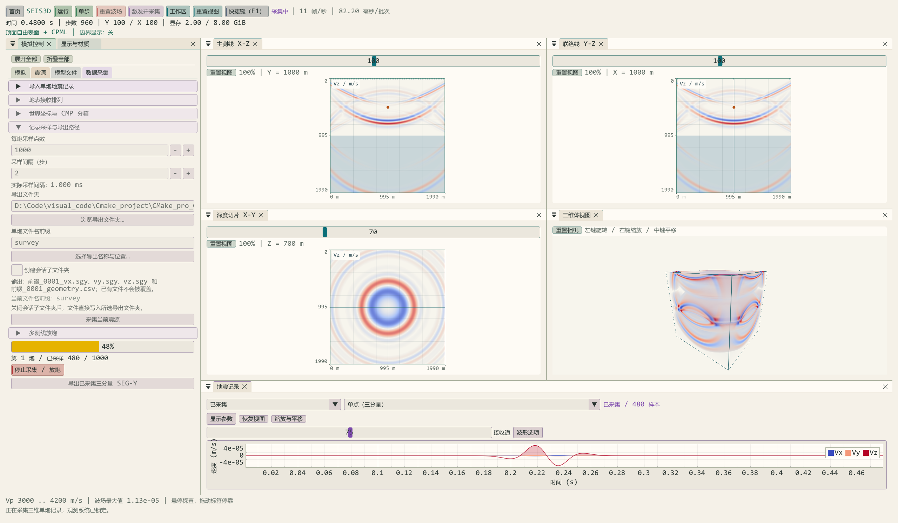


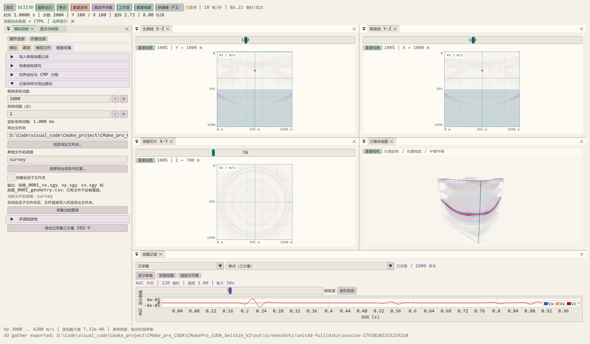

本次单炮完整记录为150道×1000点，采样间隔1ms，首末样点0.75～999.75ms。SEG-Y与几何CSV由当前真实CUDA计算输出。

### 7.3 接收选行、AGC 与记录样式

记录区可查看单个接收点的三分量，也可显示全部接收点、固定 Y 的一排 X 测线，或固定 X 的一排 Y 测线。默认面阵每排 50 道，选择中间 X 排即可集中观察一条测线。**All traces** 根据当前数据和选行的实际道数更新显示上限，不再固定为 64、100 或 128 道。

**Automatic gain compensation（AGC）** 使用滑动窗口 RMS 增强弱信号，提供窗口长度、补偿强度、最大增强倍数和噪声地板参数；预填窗口 120 ms、最大增强 50 倍，默认关闭。AGC 与 Trace gain 只作用于显示副本，正式 SEG-Y 保留原始采样振幅。

二维与三维查看器共用六种记录样式：**Wiggle、Variable area、Density image、Density + wiggle、Signed lobes、Density + signed lobes**，支持自定义组合、十四套波场同类色带、密度范围与透明度。切换样式、色带、分量和选行保留显示增益及 AGC 设置。

图内滚轮缩放时间轴和地震道轴，单独在轴上滚轮只缩放该轴；左键拖动平移，Reset View 恢复适配。手动缩放后自动退出连续 Auto fit，避免下一帧把视图拉回。每道预览最多保留 2048 个显示点，原始样本不变。


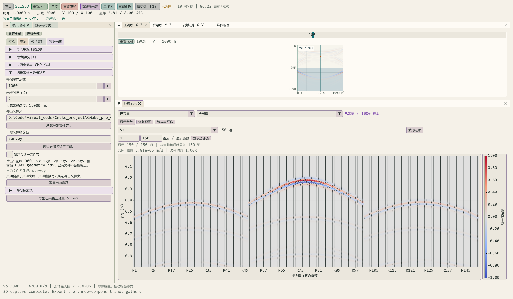


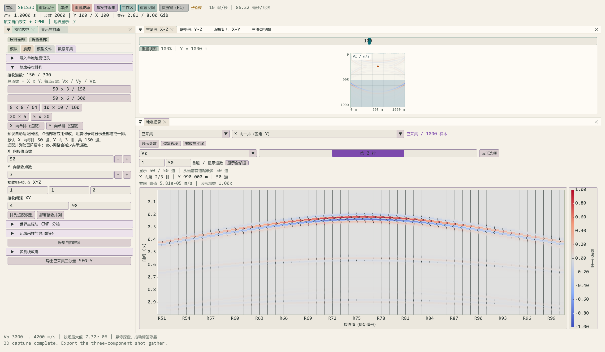


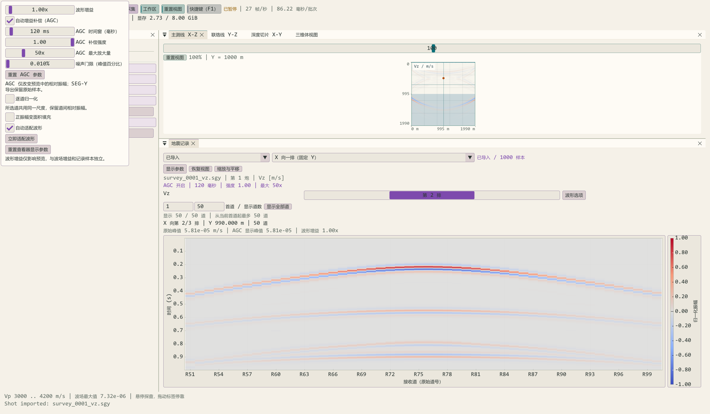


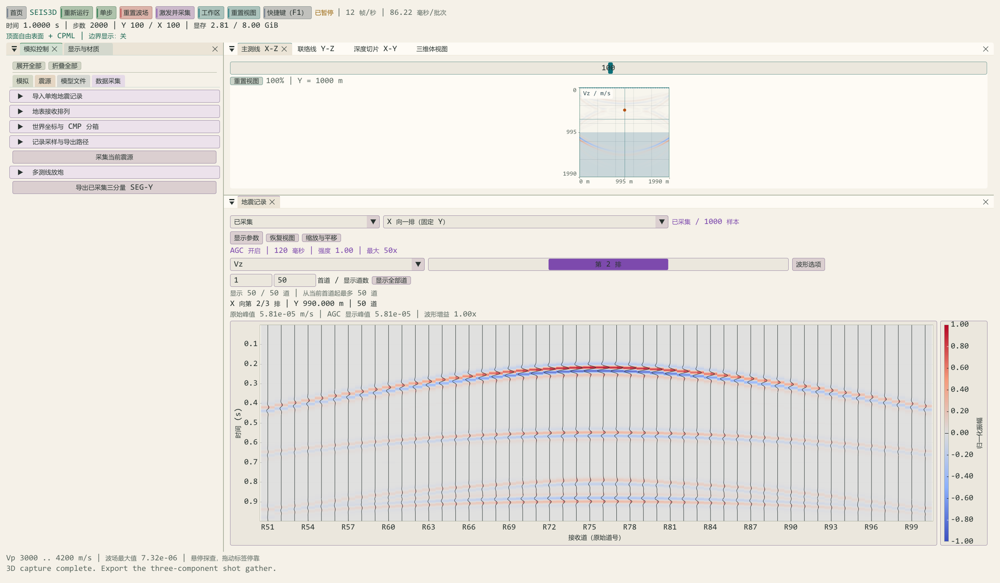


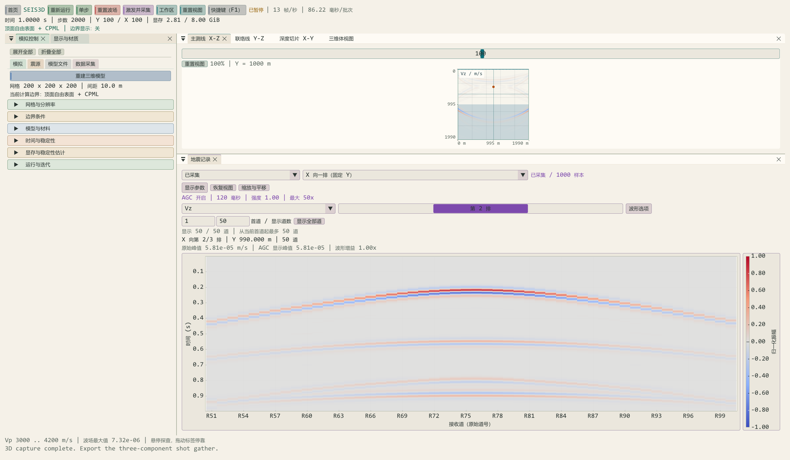

记录分析采用软件内置Receiver focus布局，时间轴覆盖完整道集，PNG仍为完整窗口原图。AGC截图只对显示副本补偿，原始数据保持不变。

### 7.4 外部单炮地震记录导入

**Import shot record** 可独立导入单炮 SEG-Y，不要求先初始化 GPU 模型。当前支持大端 rev0/rev1 的 IBM/IEEE float32 和 32/16/8 位有符号整数样本，要求单炮、单分量、统一道长和采样间隔；上限为 4096 道、每道 32767 样点及 256 MiB CPU 样本缓冲。导入查看器上限与三维正演的 300 道接收上限分别管理。

导入保留道号、源检坐标及每道起始延迟；不支持的 rev2、小端、变长道或多炮混合文件会明确拒绝。导入数据可使用相同的 AGC、色带与缩放控件，并与当前模拟资源隔离。


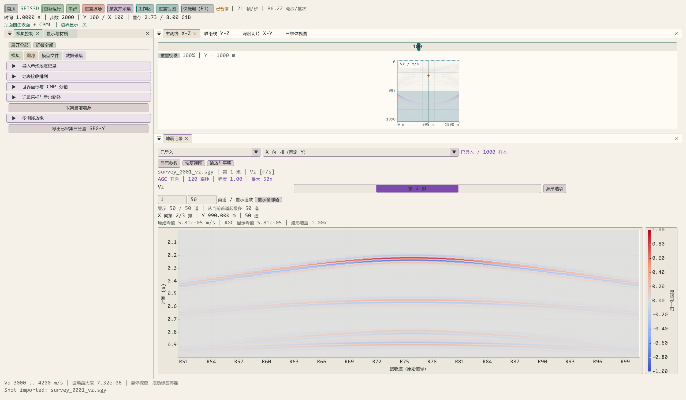

## 8. 快速复现一个示例

| 参数 | 设置 |
| --- | --- |
| 物理网格 | 300 × 50 × 300，当前默认 |
| 网格间距 | 10 m |
| 模型 | Two layers |
| CPML 厚度 | 12 格 |
| 顶部自由表面 | 开启 |
| Ricker 主频 | 20 Hz |
| CFL 安全系数 | 0.85 |
| 求解步长 | Automatic CFL，默认模型约 0.908 ms；可手动设 0.5 ms 后重建 |
| 接收网格 | X 向 50 道、Y 向 3 排，共 150 道，上限 300 |
| 每炮采样 | 1000 样点，stride=2 |
| 每帧计算 / 停止步数 | 2 / 2000，按所需物理时长调整 |
| 初始波场外观 | Vz + Geological layers + Coolwarm，历史峰值保持关闭 |
| 本文截图条件 | 200³、手动0.5ms、Paper Sand + Paper scientific、Vz、1.8倍增益 |

1. 首页进入三维沙盒，在 Simulation 中配置上述参数。
2. 点击 Initialize 3D；已有会话时点击 Rebuild 3D session。
3. 在 Display / materials 中保留 Vz、Geological layers 和 Coolwarm；界面可选择 Paper Sand 或其他浅色主题。想采用文章的演示配色时切换 Paper scientific，已有增益不会被复原。
4. 点击 Run，等待子波起振和传播，观察三个剖面与 Live 曲线。
5. Pause 后通过滚轮、拾取和轨道相机检查空间波场。
6. 在 Acquisition 中配置并 Deploy mesh，确认 50 × 3 接收排列，设置 1000 样点、采样步数和导出目录／文件名前缀。
7. 点击 Fire + capture，采集完成后在 Captured 中观察全部道或中间一排。按需开启 AGC、调整色带和缩放时间轴，再导出原始三分量 SEG-Y。

模型可保存为 `.s3dm` 文件，包含物理网格的 Vp、Vs 和密度。导入后重新检查物性、计算最大 Vp 并同步安全时步；CPML 与差分保护区由程序重建。

GRID / RESOLUTION 的预设为 **500 × 20 × 500、200³、300³、300 × 300 × 400**；旧 96³、160³ 按钮已取消，但符合节点与显存约束的自定义小网格仍可输入。修改物理网格、材料、边界或求解步长后重建会话；仅切换视图、色带、语言和记录样式无需重建。


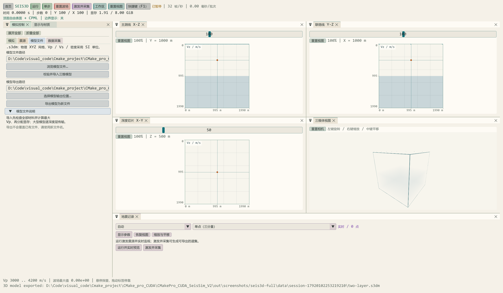


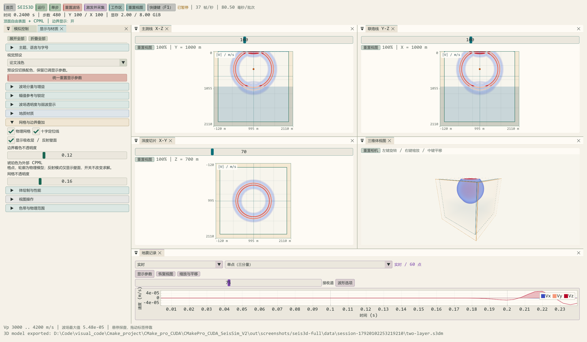

## 9. 显存预算与运行范围

三维网格随尺寸增长带来显著的内存需求。Seis3D 使用薄层 CPML、独立资源生命周期和受限辅助显示体控制开销，分配前查询实际剩余显存并保留余量。

下表来自当前代码预算，条件为 **12 格 CPML、自由表面开启**，包含填充后的物理场、材料、CPML 与显示缓冲：

| 物理网格 | 物理节点数 | 预计总预算 |
| --- | ---: | ---: |
| 300 × 50 × 300（默认） | 450 万 | 0.554 GiB |
| 500 × 20 × 500 | 500 万 | 0.873 GiB |
| 200³ | 800 万 | 0.771 GiB |
| 300³ | 2700 万 | 1.987 GiB |
| 300 × 300 × 400 | 3600 万 | 2.516 GiB |

**这些数值为当前预算公式估算，不是实测显存峰值或性能基准。** 表格包含填充后的九个波场、三种材料、边界记忆变量、CUDA/GL 显示缓冲，以及最坏 1536² 体绘制输出预算；不含 CPU 道集。薄的 Y 方向模型边界占比更大，因此相近节点数不一定具有相近预算。

物理网格要求各轴至少 16 点、**X × Y × Z ≤ 36,000,000**，不再把单边固定锁在 512 点。尺寸可动态组合，例如 600 × 200 × 200 满足总节点约束；实际初始化还需满足 4 GiB 单次预算、设备空闲显存、CUDA 启动和 OpenGL 纹理限制。CPML 不计入物理节点上限，但计入显存预算。

分配前保留至少 512 MiB 或设备总显存五分之一的余量，取两者较大值。驱动、CUDA 模块和其他应用仍有额外占用；大网格运行速度受 GPU、显示频率和体绘制设置影响。建议从默认 300 × 50 × 300 或更小的自定义模型起步，再逐级增加规模。

本文截图运行于 NVIDIA GeForce RTX 4060 Laptop GPU（8 GB）。本次实际展示为200³模型，截图中的FPS为当时界面状态，不代表大网格求解性能基准。

## 10. 当前阶段与后续方向

当前版本已经形成模型配置、三维计算、空间观察、三分量采集和数据导出的完整交互流程，并已有显示、采集、交互与资源释放的集成检查。

配套录制了约 **8 分钟**的三维地震勘探流程演示，介绍模型、震源与接收排列设置，以及波场传播和地震记录采集，适合先了解软件的实际操作和呈现方式。

用于定量地震研究前，还需要系统开展 P/S 波到时、网格收敛性、自由表面响应、CPML 斜入射与角点反射、长时间稳定性及第三方 SEG-Y 兼容性验证。

后续迭代将围绕三条方向展开：

- **数值验证**：建立可重复的解析解与参考解对照，明确误差、边界反射和适用频率范围。
- **计算与交互**：在有测量依据的前提下优化 CUDA 核函数、显示抽取与大模型工作流。
- **数据与模型**：完善后台 I/O、采集分析和更复杂介质的扩展接口。

Seis3D 为三维地震波传播提供了可直接操作的观察环境，也为后续算法开发保留了相对独立的求解、渲染和采集模块。

---

## 11. 二维工作流与同类记录分析

二维沙盒保留独立的GPU上下文和右侧控制面板。本文同步重新采集8张2560×1494完整窗口图：256×160双层介质、60Hz垂向源、100个接收点；正式记录在0.1s暂停，冻结100道×500样点，间隔0.2ms。它与三维演示使用不同算例，不能直接比较传播时间或振幅。

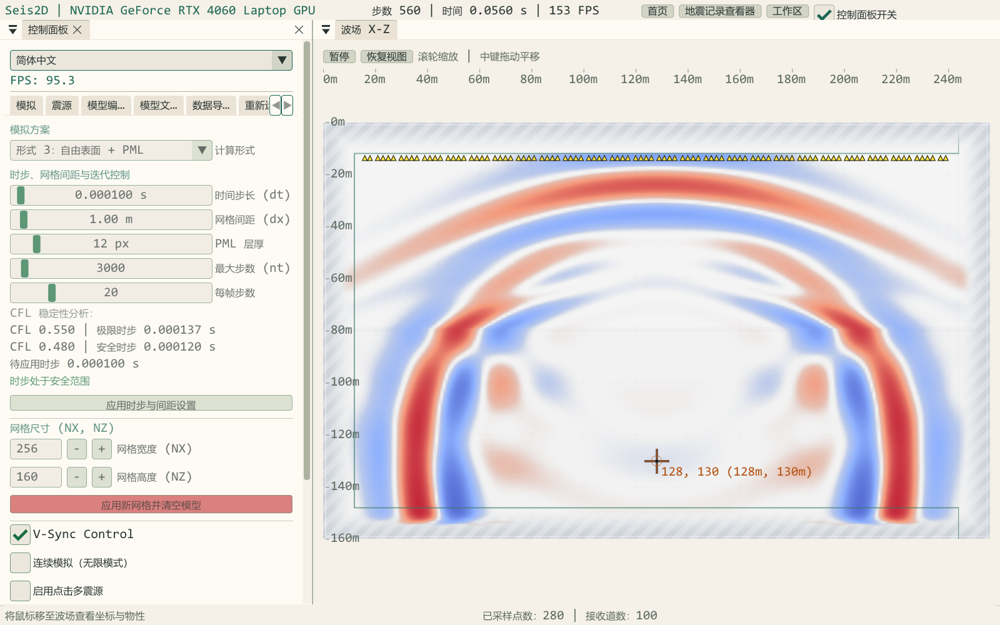

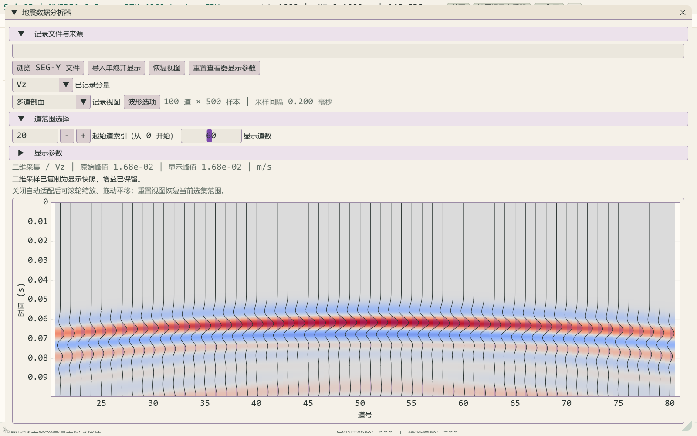

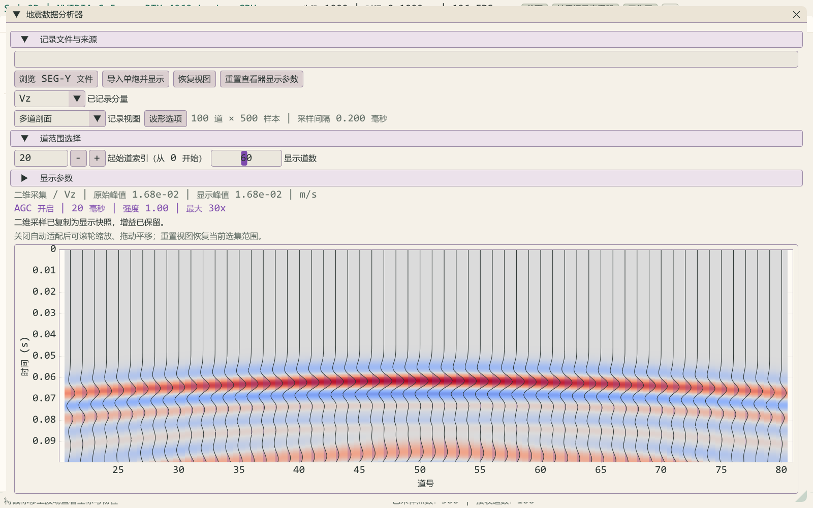

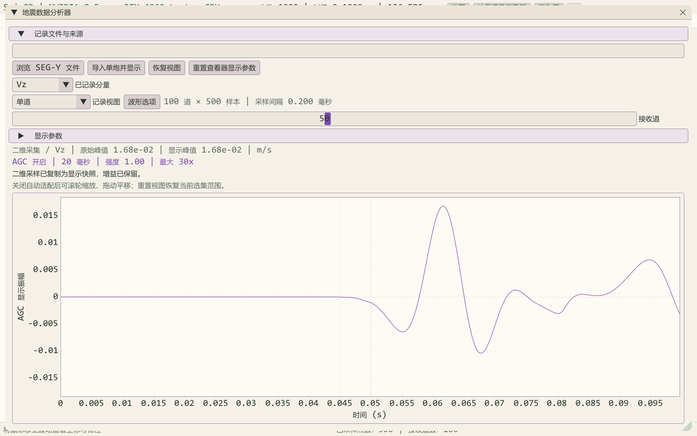

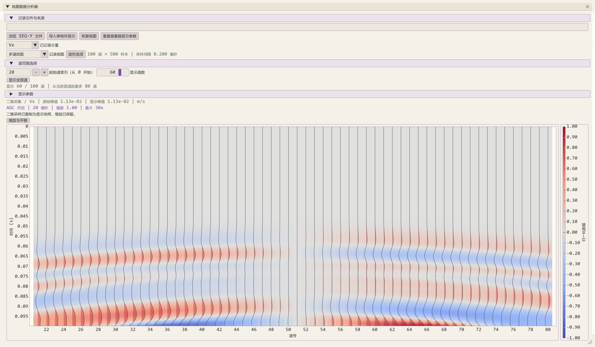

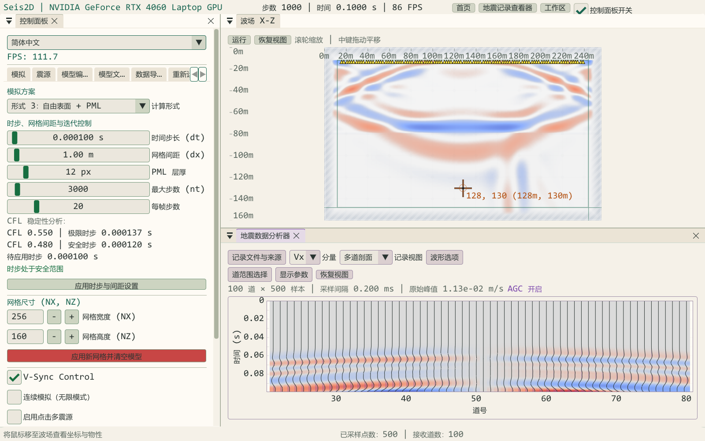

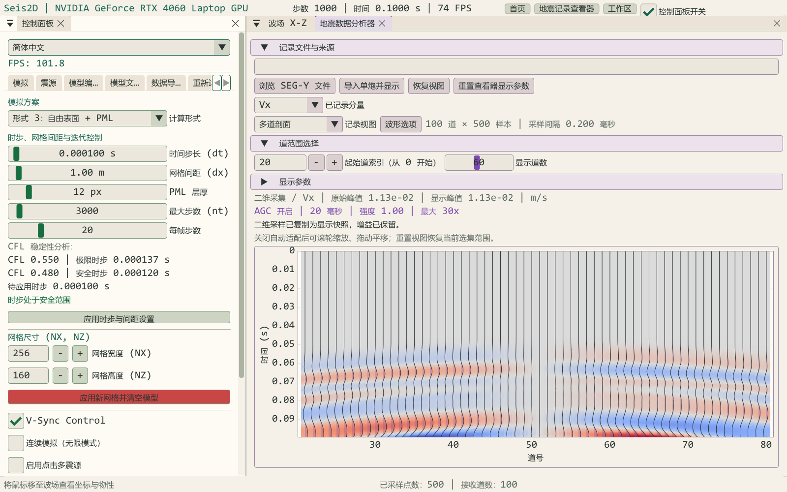

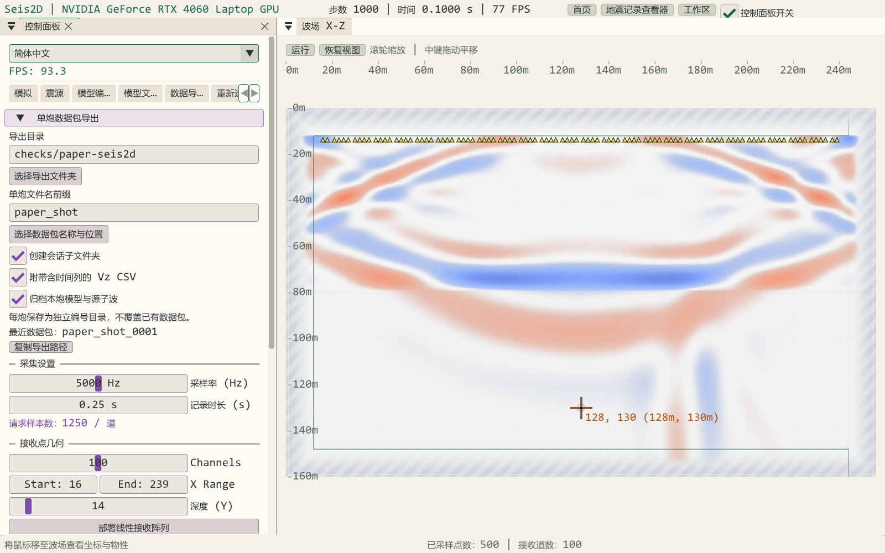

原始与AGC截图使用同一冻结记录，展示第21至80道。AGC窗口20ms、强度1、最大30倍，属于显示补偿。导出截图演示单炮文件与有效多炮编辑值，未将配置画面作为多炮完成结果。二维与三维查看器提供相近的增益、色带和缩放操作，数据与会话分别管理。

---

**项目源码：** [SeisWave Lab / CMakePro_CUDA_SeisSim_V2](https://github.com/XiaoYu-1111/CMakePro_CUDA_SeisSim_V2)

本文根据项目的 Seis3D_User_Guide、当前代码与实现说明整理，内容更新于 **2026 年 10 月 15 日**，软件版本 **v2.0.0**。全部插图来自本次真实程序运行，保留2560×1494原生完整窗口。模型、波场和采集结果未重新绘制或着色；三维33张与二维8张原图及采集条件记录随发布包提供。
