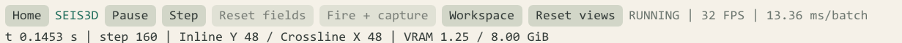
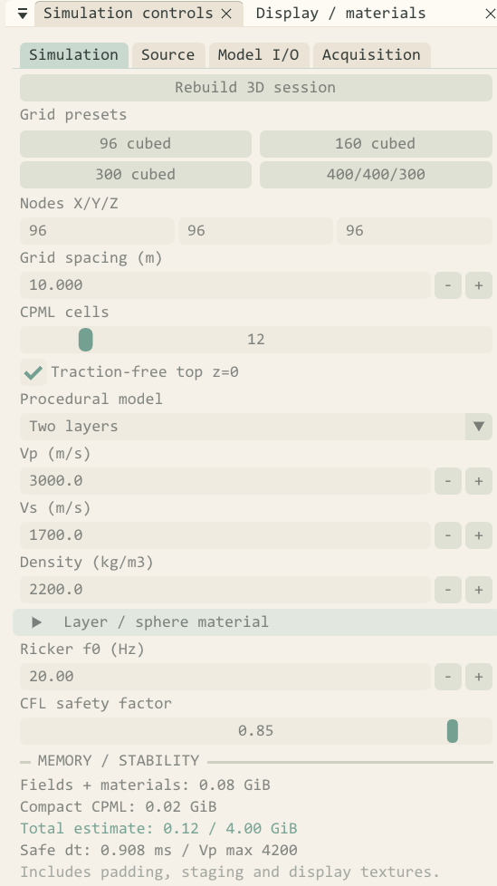

# Seis3D 三维地震波模拟使用说明

适用项目 CMakePro CUDA SeisSim V2　更新日期 2026 年 10 月 12 日

本文说明如何建立三维弹性介质模型、运行波场、查看正交剖面与体视图，以及采集和导出三分量地震记录。示例统一使用 Paper Sand 界面与 Paper scientific 显示预设，模型采用浅色分层，波场采用蓝红配色。

## 1 首页与模式选择

图1　Paper Sand 首页实际截图。右侧卡片进入三维空间探索沙盒。

首页显示当前 CUDA 设备、显存容量和二维与三维两个独立入口。选择 **进入三维工作区** 打开 Seis3D；选择二维卡片则进入原二维模拟流程。

主题菜单位于首页右上角。选择 **Paper Sand** 后，界面采用暖白底色、深灰文字和青绿色控件。进入三维后，在 **Display / materials → Visual preset** 中选择 **Paper scientific**，模型与波场会使用配套的浅色画布。

本指南依次介绍工作区、快速运行、参数与震源、剖面交互、显示设置、体视图、采集导出、模型与计算边界，以及常见问题。

二维与三维采用独立模拟状态。返回首页切换模式时，程序释放原模式的 GPU 和图形资源；再次进入三维后需要重新初始化波场。

<!-- pagebreak -->

## 2 三维工作区总览

图2　96³ 双层模型的实际运行界面。示例时刻约 0.1453 s，计算到第 160 步，采集预览已有 80 个样本。

| 区域 | 显示内容 | 常用操作 |
| --- | --- | --- |
| 顶部工具栏 | Run、Step、Reset fields、Fire + capture、Workspace | 运行、单步、重置、采集和布局切换 |
| 左侧参数区 | Simulation、Source、Model I/O、Acquisition | 编辑模型、震源、接收点和导出路径 |
| 左侧显示标签 | Display / materials | 主题、配色、物性与显示强度 |
| 中央四视图 | 三个正交剖面和 Spatial volume | 剖面缩放、位置联动与轨道观察 |
| 底部曲线区 | Receiver traces | 选择接收点与 Live 或 Captured 数据 |

顶部状态栏显示模拟时间、计算步数、Inline Y 与 Crossline X 位置、显存占用和帧率。底部状态栏显示鼠标拾取的格点、物理坐标、Vp、Vs、密度以及最近操作提示。

窗口标签可以拖动、合并和重新停靠。需要恢复本图布局时，选择 **Workspace → Four views**；若某个窗口被关闭，在 Workspace 菜单中重新打开。

<!-- pagebreak -->

## 3 快速运行一个示例

首次使用建议以 96³ 网格开始，确认模型、震源和接收点流程后再增加尺寸。

| 参数 | 入门示例 | 说明 |
| --- | --- | --- |
| Nodes X / Y / Z | 96 / 96 / 96 | 物理网格节点数 |
| Grid spacing | 10 m | 三方向使用相同间距 |
| CPML cells | 12 | 吸收层厚度 |
| Traction-free top z=0 | 开启 | 顶部 Z 为 0 的平面自由表面 |
| Procedural model | Two layers | 双层介质 |
| Ricker f0 | 20 Hz | 主频 |
| CFL safety factor | 0.85 | 自动安全时步的系数 |
| Receiver mesh | 10 × 10 | 共 100 个接收点 |

1. 在首页进入三维工作区，打开 **Simulation** 标签。
2. 选择 **96 cubed** 和 **Two layers**，保留 10 m 间距与 12 格 CPML。
3. 点击 **Initialize 3D**。已有会话时按钮显示 **Rebuild 3D session**。检查底部没有错误提示。
4. 打开 **Display / materials**，选择 **Paper Sand** 与 **Paper scientific**。
5. 点击 **Run**。程序发射震源，并在底部生成真实接收点的实时波形；也可点击 Step 单步推进。
6. 点击 Pause 暂停观察，使用剖面滑块、滚轮和中键探索波场。
7. 需要正式道集时点击 **Fire + capture**。普通 Run 的实时预览与正式采集分别保存。

图3　顶部运行与采集控制。达到停止步数后，Run 会变为 Replay，用于重新发射震源。

初始化会根据模型最大 Vp 自动同步安全时步。该双层示例的时步为 0.908 ms；具体值以当前模型的状态显示为准。说明书截图使用每帧 8 步，普通默认值为每帧 2 步。

<!-- pagebreak -->

## 4 模型参数与震源

图4　Simulation 参数区局部截图。正式采集中，模型与震源相关参数锁定，控件显示为禁用状态。

**Simulation** 设置网格、间距、CPML、自由表面和材料。Vp 与 Vs 的单位为 m/s，密度单位为 kg/m³；Layer / sphere material 可设置第二层或球形异常体的物性。模型参数变更后需要重新初始化会话。

**Source** 设置震源格点 XYZ、机制和幅值。爆炸源的幅值单位为 Pa/s，定向体力源为 N/m³；体力源可设置方向并使用 Normalize direction 归一化。Center slices on source 将三个剖面移到震源处，Reset wavefield + fire 从新波场开始发射。

震源波形为 Ricker 子波，主频在 Simulation 中设置，时间延迟为主频倒数的 1.2 倍。初始短时间尚无明显波前属于子波起振过程；可适当推进计算再观察。

<!-- pagebreak -->

## 5 正交剖面与坐标拾取

图5　浅色双层材料上的速度幅值波场。标尺单位为米，交叉线指示联动的剖面位置。

| 剖面 | 固定方向 | 图像坐标 |
| --- | --- | --- |
| Inline X Z | Y | 水平 X，垂直 Z |
| Crossline Y Z | X | 水平 Y，垂直 Z |
| Depth X Y | Z | 水平 X，垂直 Y |

| 输入 | 操作效果 |
| --- | --- |
| 滚轮 | 围绕鼠标位置缩放，范围 100% 至 3200% |
| 中键拖动 | 平移当前剖面 |
| 左键单击 | 拾取格点并联动三个剖面位置 |
| Reset view | 恢复当前剖面全景 |
| Reset views 或 R | 重置三个剖面与轨道相机 |

各剖面独立保存缩放与平移。标尺、交叉线、震源与接收点标记共用同一坐标变换，放大后仍按真实模型格点拾取。Z 为深度方向，向下增大。

本例 96 个节点、10 m 间距，节点中心的坐标范围为 0 至 950 m。差分保护层与模型外部 CPML 填充层不属于导出模型的物理节点。

<!-- pagebreak -->

## 6 显示样式与模型材质

图6　Paper Sand 与 Paper scientific 配套设置。局部截图展示分量、色带、增益及材料选项。

推荐组合为 **Paper Sand + Paper scientific**。该预设使用 Scientific White 浅色材料、Coolwarm 蓝红色带和浅色体视图背景，显示速度幅值。Display gain 为 1.8，Wave opacity 为 1.0，Weak wave visibility 为 0.50，材料背景亮度为 1.0。

在 **Display** 中，Model + wavefield 将波场叠加在材料上；Wavefield only 隐藏材料；Material only 单独检查物性分层。材料可以选择 Vp、Vs 或 Density，自动范围依据当前可见数据计算。比较不同位置时，可用 Freeze visible material range 固定范围。

速度幅值的蓝红色带表示非负幅值大小。分析极性时应改为 Vx、Vy 或 Vz，并查看对应的带符号图例。单个速度分量可能在对称剖面上接近零，检查全部波前时宜先选择 Velocity magnitude。

Weak wave visibility 数值越小，弱波越明显；Wave cutoff 过滤低幅值区域。自动尺度随当前场变化，跨时刻比较振幅时应使用相同手动尺度。增益、透明度和颜色属于显示映射，采集记录仍使用物理单位。

<!-- pagebreak -->

## 7 体视图与停靠布局

图7　浅色背景上的半透明三维波场。青灰色包围盒表示物理模型范围。

| 输入或按钮 | 体视图操作 |
| --- | --- |
| 左键拖动 | 围绕模型旋转 |
| 右键拖动或滚轮 | 缩放轨道相机 |
| 中键拖动 | 平移观察中心 |
| Reset camera | 恢复默认相机 |

| 工作区预设 | 使用场景 |
| --- | --- |
| Four views | 同时比较三个剖面与体视图 |
| Volume focus | 放大体视图，以标签页切换剖面 |
| Compact / tabbed | 较小窗口中使用合并标签页 |

体绘制使用每轴最多 128 点的辅助显示体；三剖面使用完整物理网格。体图适合观察整体传播形态，薄层、细小波前和定量振幅应结合剖面与采集曲线判断。

Auxiliary volume raymarch 可关闭体绘制，Cloud opacity 与 Cloud cutoff 控制云图透明度和阈值。Display every N steps 调整显示更新频率；大型网格可减少显示更新次数以降低渲染开销。

<!-- pagebreak -->

## 8 接收采集与 SEG Y 导出

图8　实际采集中的 Vx、Vy、Vz 曲线。预览可切换接收点，横轴为秒，纵轴为 m/s。

1. 初始化模型后，打开 **Acquisition** 标签。
2. 选择 **10 × 10 / 100**。总道数等于 X 点数乘以 Y 点数，上限为 100。
3. 设置接收点原点、XY 间距及深度 Z；地表接收可使用 Z 为 0。
4. 需要自动适配模型范围时点击 **Fit spread to model**，再点击 **Deploy mesh** 应用。
5. 设置 Samples per shot、Sample stride 和 Export folder。
6. 点击 **Capture current source** 或顶部 **Fire + capture**，等待当前炮采集完成。
7. 点击 **Export captured 3-C SEG-Y** 导出三分量道集。

| 预览类型 | 数据来源 | 保存方式 |
| --- | --- | --- |
| Live monitor | 普通 Run 每个计算批次抽取 | 最近 512 帧的有界预览 |
| Captured gather | 按指定采样步距正式采集 | 独立的 CPU 道集快照 |
| Auto preview | 依据运行或采集状态自动选择 | 不改变两类数据的采样方式 |

实际采样间隔等于 Sample stride 乘以安全时步。例如本模型 stride 为 2，间隔为 1.816 ms。首样本位于速度半时间步，准确起点也写入几何 CSV。Live 预览按批次记录，应使用正式采集获得均匀采样的导出道集。

每炮输出 `_vx.sgy`、`_vy.sgy`、`_vz.sgy` 和 `_geometry.csv`，每个分量文件最多包含 100 道。多测线放炮使用 Shots per line、Source line count 和 Shot spacing，并通过 Start spread + auto export 自动逐炮采集与导出。

<!-- pagebreak -->

## 9 模型文件与计算边界

**Model I/O** 使用 `.s3dm` 三维模型。文件保存物理 XYZ 网格的 Vp、Vs、密度，X 方向连续；CPML 和差分填充区由程序重建。导入时逐单元检查材料并求最大 Vp，然后计算安全时步与显存预算。导出模型时使用新文件名。

| 物理网格 | 代码估算的总显存预算 | 适用起点 |
| --- | --- | --- |
| 96³ | 0.121 GiB | 熟悉交互与采集 |
| 160³ | 0.378 GiB | 中等规模探索 |
| 300³ | 1.759 GiB | 较大三维模型 |
| 400 × 400 × 300 | 2.909 GiB | 根据实际空闲显存选择 |

预算对应 12 格 CPML、自由表面开启，包含物理场、材料、CPML 与显示缓冲。驱动、CUDA 模块和其他应用另有占用，顶部 VRAM 数值通常大于本表预算。单次预算上限为 4 GiB，分配时还会预留设备显存余量。

求解器采用三维各向同性一阶速度应力方程，包含 3 个速度分量和 6 个独立应力分量。内部空间为八阶交错差分，时间为二阶交错推进，吸收边界采用薄层记忆变量 CPML。平面自由表面的离散闭合为二阶，当前不支持起伏地形。

正式单炮最多 32767 个样本，实际采样间隔最多 32767 微秒，三分量 CPU 道集缓冲上限为 512 MiB。SEG-Y 导出记录源检坐标、CMP Inline 与 Crossline 分箱标号；当前未实现 CMP 叠加、偏移成像或投影坐标转换。

当前已有显示、采集、交互和资源释放的集成检查。用于定量地震研究前，仍需完成 P/S 到时、收敛性、自由表面、CPML 反射和长期稳定性验证。详细实现和文件格式见三维实现说明。

<!-- pagebreak -->

## 10 常见问题与文档位置

| 现象 | 检查与处理 |
| --- | --- |
| 只有网格，没有材料或波场 | 先初始化模型；切换 Material only 检查材料，再选择 Paper scientific 和 Run。旧发布版可按构建说明完整重建 |
| 某个剖面波场接近空白 | 单分量可能处于对称面；先改为 Velocity magnitude，并将剖面移到震源附近 |
| 底部没有波形或暂时为零 | Run 生成 Live 预览，正式数据使用 Fire + capture；允许传播时间，并选择较近接收点 |
| 运行到终止后再次点击没有新波前 | 使用 Replay 重新发射，或 Reset fields 后 Run |
| 改了模型但显示仍是旧材料 | 重新初始化会话；采集中先停止采集再编辑 |
| 模型较大时初始化失败 | 查看底部错误和实际空闲显存，先使用较小网格 |
| 窗口布局混乱或窗口关闭 | Workspace 重新应用 Four views，或重新打开对应窗口 |

| 快捷键 | 操作 |
| --- | --- |
| Space | 运行或暂停 |
| C | 重置波场并暂停 |
| R | 恢复三剖面与轨道相机 |
| Tab | 返回首页并执行模式资源释放 |

本指南的 Markdown 位于 `docs/user`，实际截图位于 `docs/assets/seis3d`，可编辑 Word 位于外层 `out/docs`。运行程序和资源统一位于外层 `out/bin`。

- [文档导航](../README.md)
- [构建与输出说明](../build/BUILDING.md)
- [三维实现和格式说明](../development/SEIS3D_IMPLEMENTATION.md)
- [二维稳定性历史审查](../reviews/NUMERICAL_STABILITY_REVIEW.md)

本说明书的首页、工作区及显示设置截图均来自同一次 Paper Sand 实际程序截图会话。局部图只做裁切。图中速度幅值、材料分层和接收波形均为程序计算结果。
